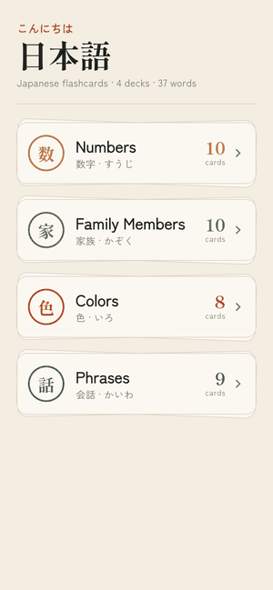
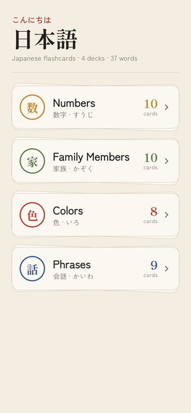
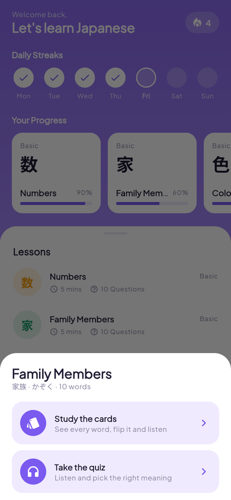
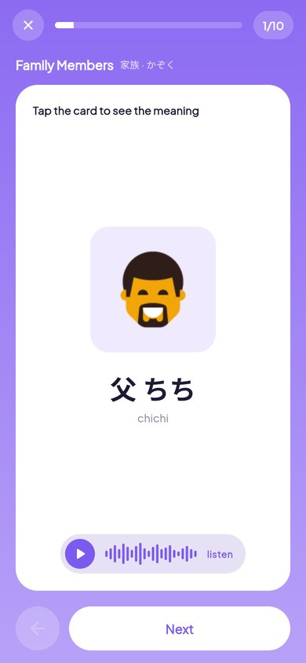
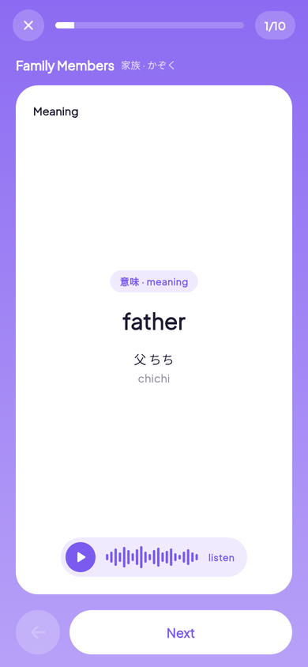
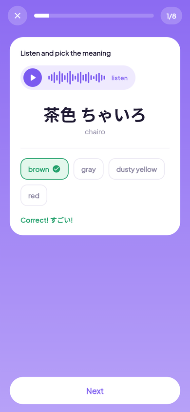
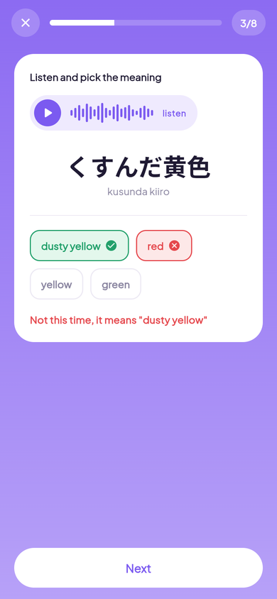
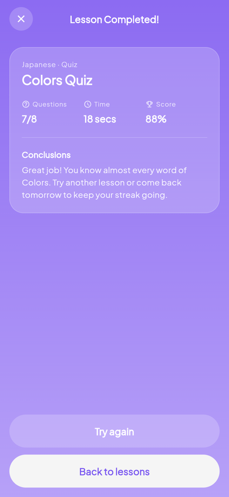

# Japanese Flashcards 日本語

A small Flutter app I made to learn my first Japanese words. You pick a lesson
(numbers, family members, colors or phrases), then you can study the cards or
take a listening quiz. The app remembers your best score for every lesson and
the days you practiced, so you can keep a daily streak.

**Live demo:** https://sirine2907.github.io/language_learning_app/

<p align="center">
  
</p>

## Features

- 4 lessons: Numbers (10), Family Members (10), Colors (8), Phrases (9)
- **Study the cards:** every card shows the word in kanji + kana and romaji,
  tap it to flip and see the English meaning, press listen to hear it
- **Quiz:** listen to the word and pick the right meaning out of 4,
  the answer turns green or red right away
- **Lesson completed** page with the number of questions, the time and the score
- **Daily streak** (Mon to Sun) and **progress** cards with the best quiz score of each lesson
- Everything is saved on the phone with shared_preferences
- Swipe left / right or use the buttons to move between cards

## Screenshots

| Home | Choose a mode | Card | Meaning |
|---|---|---|---|
|  |  |  |  |

| Quiz | Wrong answer | Lesson completed |
|---|---|---|
|  |  |  |

## Built with

- Flutter / Dart
- [flutter_bloc](https://pub.dev/packages/flutter_bloc) for state management
- [equatable](https://pub.dev/packages/equatable) to compare states
- [audioplayers](https://pub.dev/packages/audioplayers) for the sounds
- [shared_preferences](https://pub.dev/packages/shared_preferences) to save scores and streak days
- [google_fonts](https://pub.dev/packages/google_fonts) (Plus Jakarta Sans, and Noto Sans JP for the Japanese words)
- bloc_test and mocktail for the tests

## How the code is organized

I used clean architecture with 3 features. The UI never knows where the data
comes from, it only talks to a bloc, the bloc uses a use case, and the use case
asks a repository.

```
lib/
├── main.dart                   creates the repositories and the sound player
├── app.dart                    MaterialApp, theme and providers
├── core/
│   ├── audio/                  SoundPlayer (one AudioPlayer for the whole app)
│   ├── theme/                  colors and text styles
│   └── widgets/                purple background, top bar, sound button, big button
└── features/
    ├── lessons/                the words and the flashcards
    │   ├── domain/             Word, Category, LessonRepository, GetCategories, GetWords
    │   ├── data/               local data source with all the words
    │   └── presentation/       CategoriesBloc, DeckBloc, HomePage, FlashcardsPage
    ├── quiz/
    │   ├── domain/             Question, MakeQuiz (builds 4 options for every word)
    │   └── presentation/       QuizBloc, QuizPage, answer chips
    └── progress/
        ├── domain/             Progress (best scores + practice days, streak), GetProgress, SaveResult
        ├── data/               shared_preferences data source
        └── presentation/       ProgressBloc, ResultPage
```

How the quiz works:

1. `QuizPage` is opened with a `QuizBloc` and the event `QuizStarted(categoryId)`
2. the bloc calls `MakeQuiz`, which takes the words of the lesson and adds 3 wrong
   meanings from other words of the same lesson to every question
3. tapping an answer sends `AnswerSelected`, the bloc checks it and counts the right ones
4. after the last question the bloc calls `SaveResult` with the score, which keeps the
   best score and saves today for the streak
5. the page sees the `finished` status and opens the `ResultPage`

## Run it

You need Flutter installed (I used Flutter 3.16).

```bash
git clone https://github.com/sirine2907/language_learning_app.git
cd language_learning_app
flutter pub get
flutter run
```

Run it in the browser:

```bash
flutter run -d chrome
```

## Tests

```bash
flutter test
```

There are tests for the repositories, the streak, the quiz questions, all the blocs
and the flashcard widget.

## What I want to add next

- a "write what you hear" quiz where you build the answer from words
- more lessons (animals, food, days of the week)
- dark mode
