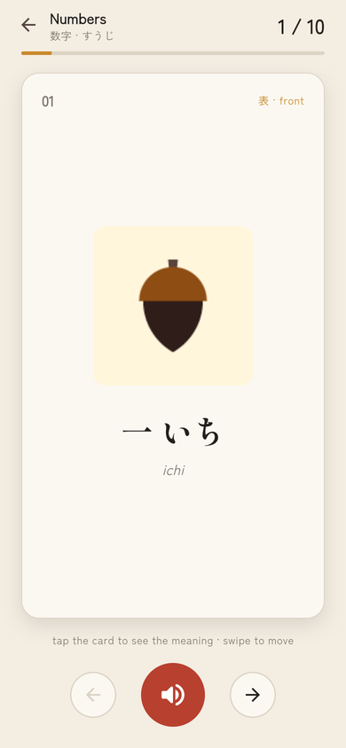
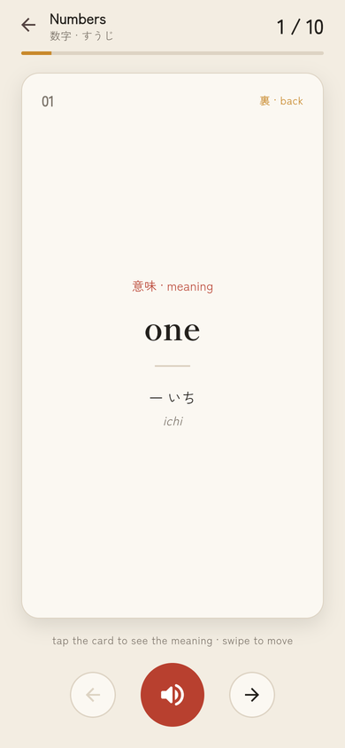
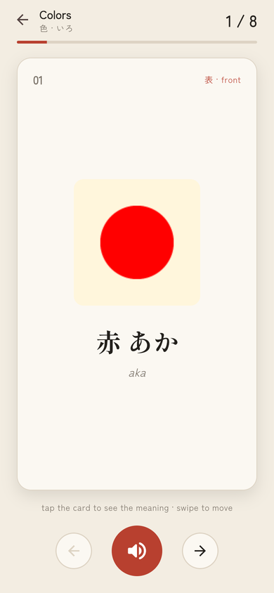
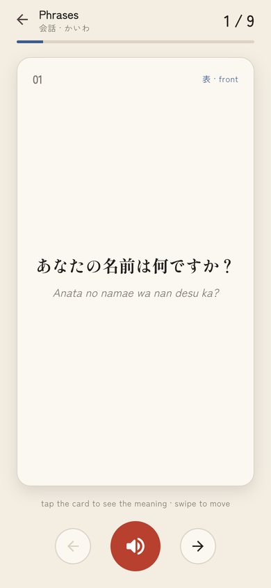
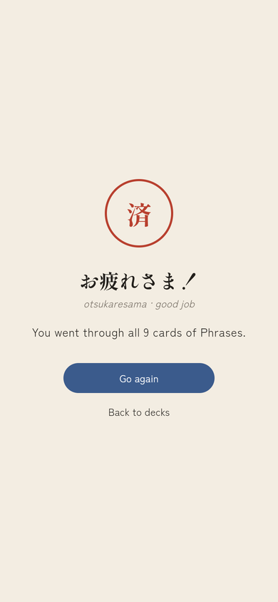

# Japanese Flashcards 日本語

A small Flutter app I made to learn my first Japanese words. You pick a deck
(numbers, family members, colors or phrases), go through the cards one by one,
tap a card to see what it means and press the speaker to hear how it is said.

**Live demo:** https://sirine2907.github.io/language_learning_app/

<p align="center">
  
</p>

## Features

- 4 decks: Numbers (10), Family Members (10), Colors (8), Phrases (9)
- Every card shows the word in Japanese (kanji + kana) and in romaji
- Tap the card to flip it and see the English meaning
- Speaker button plays the real pronunciation
- Swipe left / right or use the arrows to move between cards
- Progress bar and counter on top, and a "good job" screen at the end of a deck

## Screenshots

| Decks | Front | Back |
|---|---|---|
|  |  |  |

| Colors | Phrases | End of deck |
|---|---|---|
|  |  |  |

## Built with

- Flutter / Dart
- [flutter_bloc](https://pub.dev/packages/flutter_bloc) for state management
- [equatable](https://pub.dev/packages/equatable) to compare states
- [audioplayers](https://pub.dev/packages/audioplayers) for the sounds
- [google_fonts](https://pub.dev/packages/google_fonts) (Shippori Mincho and Zen Kaku Gothic New, both have Japanese letters)
- bloc_test and mocktail for the tests

## How the code is organized

I used clean architecture with one feature called `lessons`.
The idea is that the UI never knows where the words come from, it only talks to the bloc,
the bloc uses a use case, and the use case asks the repository.

```
lib/
├── main.dart                 creates the repository and the sound player
├── app.dart                  MaterialApp, theme and providers
├── core/
│   ├── audio/                SoundPlayer (one AudioPlayer for the whole app)
│   └── theme/                colors and text styles
└── features/lessons/
    ├── domain/               entities (Word, Category), repository interface, use cases
    ├── data/                 local data source with all the words + repository implementation
    └── presentation/
        ├── bloc/categories/  loads the decks for the home page
        ├── bloc/deck/        current card, flip, next / previous, sound, finished
        ├── pages/            HomePage, DeckPage
        └── widgets/          deck card, flashcard, buttons, finished view
```

How a card works:

1. `HomePage` opens `DeckPage` and creates a `DeckBloc` with `DeckStarted(categoryId)`
2. the bloc calls `GetWords`, which calls `LessonRepository.getWords`
3. the state has the list of words, the index of the current card and if it is flipped
4. tapping the card sends `CardFlipped`, the arrows send `NextCardPressed` / `PreviousCardPressed`
5. after the last card the status becomes `finished` and the page shows the end screen

## Run it

You need Flutter installed (I used Flutter 3.16).

```bash
git clone https://github.com/sirine2907/language_learning_app.git
cd language_learning_app
flutter pub get
flutter run
```

Run it in the browser:

```bash
flutter run -d chrome
```

## Tests

```bash
flutter test
```

There are tests for the repository, both blocs and the flashcard widget.

## What I want to add next

- a quiz mode where you pick the right meaning
- remember which cards I already know
- more decks (animals, food, days of the week)
